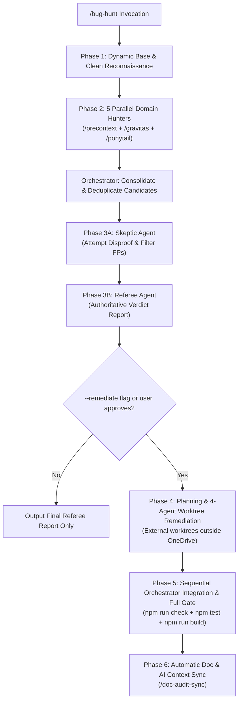

# Bug Hunt — Adversarial Multi-Domain Bug Finding & Worktree Remediation

Run an adversarial, multi-domain bug hunt and optional isolated Git worktree remediation pipeline on your codebase.

## Usage

```bash
/bug-hunt                          # Multi-domain scan of the entire project
/bug-hunt --remediate              # Scan, referee, and execute 4-agent isolated remediation
/bug-hunt src/                     # Scan specific directory
/bug-hunt -b feature-xyz           # Scan files changed in feature-xyz vs main
/bug-hunt --remediate -b feature   # Scan branch diff and remediate confirmed findings
```

---

## Mandatory Subagent Skills Triad Invariant

**CRITICAL:** Every subagent launched in this skill (Domain Hunters, Skeptic, Referee, and Remediation Worktree Agents) MUST receive the triad of skills at the top of their prompt:

```markdown
You are operating under the mandatory guidance of three skills:
1. /precontext: Read critical architecture, schemas, and use codebase-memory-mcp graph tools before exploring source. Follow strict token-efficiency invariants.
2. /gravitas: Ground every finding or change in exact file:line evidence, root cause analysis, and concrete proof.
3. /ponytail: Lazy Senior Dev Mode: the smallest complete change that fully works, zero unrequested abstractions, and surgical diffs.
```

---

## Execution Workflow



---

### Phase 1: Dynamic Base & Repository Reconnaissance

1. **Verify Target Branch & Base Commit:**
   - Execute `git branch --show-current` and `git rev-parse HEAD`. Record `BASE_SHA`.
   - Execute `git status --short`. Ensure untracked user directories (e.g. `claude-seo/`) are preserved and never force-cleaned.
2. **Parse Arguments:**
   - Check if `--remediate` is present.
   - Check if `-b <branch>` is present. If branch diff mode is selected, run `git diff --name-only <base>...<branch>`.
3. **Verify Clean Baseline:**
   - Run type checks and targeted tests to confirm existing baseline test health before dispatching hunters.

---

### Phase 2: Parallel Multi-Domain Hunters

Instead of a single hunter, launch 5 parallel domain subagents to ensure deep, token-efficient, non-overlapping coverage:

1. **Hunter 1 (Backend Services, API Routes & Core Security):**
   - Focus: Express middleware, rate limiting keys, JWT verification, session replay contracts, HTTP error sanitization, parameter tampering.
2. **Hunter 2 (Cloud Firestore, Indexes & Offline Scripts):**
   - Focus: Security rules, composite indexes, query cursor parsing, timestamp deserialization, transactional locks during participant erasure, script pagination limits.
3. **Hunter 3 (Desktop UI, Assessment Engines & Analytics):**
   - Focus: Keyboard event bubbling, spacebar duplication, accuracy score denominators with timeouts, trial pacing, active session lifecycle, chart sample aggregation.
4. **Hunter 4 (Mobile PWA, Touch Controls & Cross-Surface Parity):**
   - Focus: Hardware touch timestamp preservation (`e.nativeEvent.timeStamp`), Flanker observation schemas (`targetDirection`), restart ref resets, touch-target accessibility.
5. **Hunter 5 (Peripheral Operations, Service Workers & Edge Delivery):**
   - Focus: Service worker cache takeovers, ping timeouts, mobile route isolation from desktop shells, Vercel edge header drift (CSP/HSTS), edge routing rewrites, SEO prerender generator crashes.

**Hunter Reporting Format:**
Every hunter must return findings strictly in this compact format:
- `BUG-ID`: Sequential ID
- `Severity`: Critical / Medium / Low
- `Location`: `path/to/file.ts:line`
- `Evidence & Root Cause`: Exact code lines and behavior
- `Impact`: Security risk, data corruption, or crash
- `Minimal Fix`: Surgical 1-3 line remediation

---

### Phase 3: Adversarial Verification (Skeptic & Referee)

1. **Consolidation:**
   - Orchestrator aggregates all candidate findings from Hunters 1–5 into `scratch/candidate_findings.md`, eliminating duplicate findings across domains.
2. **Skeptic Subagent:**
   - Launch the Skeptic agent with `/precontext`, `/gravitas`, and `/ponytail`.
   - Pass only the deduplicated candidate findings.
   - Task: Challenge assumptions, inspect surrounding code, verify whether existing middleware, client retry handlers, or Vite build transforms mitigate the issue, and provide concrete code disproof for false positives.
   - Emits `scratch/skeptic_evaluation.md`.
3. **Referee Subagent:**
   - Launch the Referee agent with `/precontext`, `/gravitas`, and `/ponytail`.
   - Pass candidate findings and the skeptic evaluation.
   - Task: Adjudicate each dispute independently by reading code symbols with `codebase-memory-mcp`. Render definitive verdicts:
     - **CONFIRMED REAL BUG:** Severity, exact root cause, and minimal fix.
     - **DISMISSED (FALSE POSITIVE):** Clear justification of why it is not a defect.
   - Emits `scratch/referee_verdict_report.md`.
4. **Present Verdict:**
   - If `--remediate` was NOT specified, present the final Referee report and stop.

---

### Phase 4: Implementation Planning & 4-Agent Worktree Remediation

When `--remediate` is active:

1. **Implementation Plan Artifact (`/plan`):**
   - Write a structured implementation plan artifact (`RequestFeedback: true`).
   - Group the confirmed findings into 4 non-overlapping domain sets:
     - **Agent A (Security & Edge Deployment):** `server/routes/staticRoutes.ts`, `server/config/rateLimits.ts`, `firestore.rules`, `vercel.json`.
     - **Agent B (Backend, Repositories, Engines & Scripts):** Server services, pure engines, repositories, migration scripts, Firestore indexes.
     - **Agent C (Desktop Client & Assessment Battery):** `src/components/` assessments and datasets.
     - **Agent D (Mobile Surface, SW & Build Pipeline):** `mobile/src/components/`, `public/sw.js`, `mobile/public/sw.js`, `package.json`, `shared/seoMetadata.json`, `scripts/generate-seo-pages.mjs`.
   - Map every bug to an existing, dedicated test file with zero cross-agent test ownership overlap.
2. **External Git Worktrees Outside OneDrive:**
   - Provision 4 worktrees outside OneDrive to prevent sync file-locking:
     ```bash
     git worktree add "C:\Users\<user>\.gemini\antigravity\worktrees\<project>-fixes\fix-agent-security" -b fix/agent-security <BASE_SHA>
     git worktree add "C:\Users\<user>\.gemini\antigravity\worktrees\<project>-fixes\fix-agent-backend" -b fix/agent-backend <BASE_SHA>
     git worktree add "C:\Users\<user>\.gemini\antigravity\worktrees\<project>-fixes\fix-agent-desktop" -b fix/agent-desktop <BASE_SHA>
     git worktree add "C:\Users\<user>\.gemini\antigravity\worktrees\<project>-fixes\fix-agent-mobile" -b fix/agent-mobile <BASE_SHA>
     ```
3. **Dispatch 4 Remediation Subagents:**
   - Inject `/precontext`, `/gravitas`, and `/ponytail` into each agent prompt.
   - Each agent strictly edits only its assigned files, writes targeted regression tests, runs vitest on its test files, and commits to its branch.

---

### Phase 5: Sequential Orchestrator Integration & Full Gate

Once all 4 agents complete and commit:

1. **Sequential Branch Merge:**
   ```bash
   git checkout -b integration/audit-fixes <BASE_SHA>
   git merge fix/agent-security -m "integrate: Agent A (security & edge)"
   git merge fix/agent-backend -m "integrate: Agent B (backend & repositories)"
   git merge fix/agent-desktop -m "integrate: Agent C (desktop battery)"
   git merge fix/agent-mobile -m "integrate: Agent D (mobile, SW & build)"
   ```
2. **Execute Full Quality Gate:**
   - **TypeScript Check:** `npm run check` (0 errors across desktop and mobile).
   - **Vitest Suite:** `npm test` (100% test pass rate across all files).
   - **Production Build:** `npm run build` (Desktop SPA, Mobile PWA, SEO prerenders, Server bundle).
3. **Fast-Forward Merge & Cleanup:**
   - `git checkout main && git merge --ff-only integration/audit-fixes`
   - Remove temporary external worktrees and delete feature branches.

---

### Phase 6: Documentation Synchronization (`/doc-audit-sync`)

Immediately following the merge, invoke `/doc-audit-sync`:
1. Document all remediated bugs under a new patch version in `CHANGELOG.md`.
2. Add architectural decision record to `.ai/DECISIONS.md`.
3. Update `.ai/CONTEXT.md`, `README.md`, `docs/ARCHITECTURE.md`, and `docs/DATA_MODEL.md` to reflect modified security rules, rate limit partitioning, and version bumps.
4. Run `npm run check` and `npm test` to verify zero doc-sync regressions, and commit cleanly.
