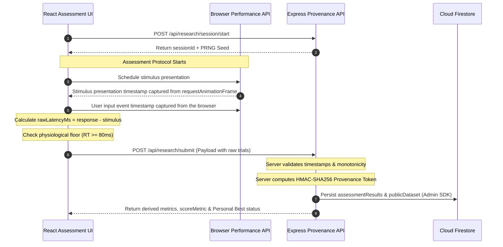

# PULSE System Architecture

This document describes the end-to-end architecture, runtime subsystems, data flow pipelines, and security boundaries of the PULSE platform.

---

## 1. System Topology Overview

PULSE uses a unified single-route responsive architecture. Both desktop and mobile viewports are served from identical canonical URLs (`/`, `/about`, `/assessments`, etc.) connected over REST/HTTPS to an Express Node.js application server, backed by Google Cloud Firestore and Firebase Authentication.

```mermaid
graph TD
    Client["Client Browser (Single Canonical Route: /)"] --> Router["Unified Router & Viewport Surface Switcher<br/>(src/App.tsx / useViewportSurface)"]
    Router -->|Desktop Breakpoint >= 768px| DesktopApp["Desktop Surface (DesktopApp)"]
    Router -->|Mobile Breakpoint < 768px| MobileApp["Mobile Surface (MobileAppWrapper)"]

    DesktopApp --> Shared["@shared Subsystem<br/>(Locks, Navigation Guard, Settings, PWA Bridge)"]
    MobileApp --> Shared

    DesktopApp -->|HTTPS / JSON| Server["Express API & Provenance Engine<br/>(server/ / Node.js)"]
    MobileApp -->|HTTPS / JSON| Server

    Server -->|Admin SDK (Signed Writes)| Firestore[("Google Cloud Firestore")]
    Server -->|Token Verification| FirebaseAuth["Firebase Authentication<br/>(Anonymous Auth)"]

    DesktopApp -.->|Read-Only Queries| Firestore
    MobileApp -.->|Read-Only Queries| Firestore
```

---

## 2. Unified Responsive Frontend Architecture

PULSE unifies desktop and mobile web experiences under single canonical routes while preserving optimized desktop and mobile layouts and shared business logic.

```
/
├── src/                      # Unified Client Entry & Desktop Application
│   ├── App.tsx               # Root router, useViewportSurface, and surface routing
│   ├── main.tsx              # Single client entry point
│   ├── DesktopApp.tsx        # Desktop application component tree
│   ├── components/           # Desktop assessment views, analytics, brand
│   ├── hooks/                # Viewport hooks (useViewportSurface)
│   └── lib/                  # Desktop state stores, timing tools, Firestore client
│
├── mobile/                   # Mobile Surface Components & PWA Shell
│   ├── src/                  # Mobile touch assessment views, components, & chart library (bklit-ui)
│   └── public/               # Mobile PWA manifest & worker assets
│
└── shared/                   # Shared Cross-Surface Subsystem (@shared)
    ├── assessment/           # Cross-surface assessment locks (assessmentLockStore)
    ├── navigation/           # Protected navigation guards (NavigationGuard, useGuardedNavigate)
    ├── lib/                  # Shared settings and preferences stores
    ├── dataset/              # Shared analytics engine (calculateDirectionalProfile, etc.)
    └── pwa/                  # Service worker session bridge and lifecycle hooks
```

> [!NOTE] The desktop `src/bklit-ui/` chart library subtree was removed in `4a452b9` (refactor: eliminate in-memory idempotency cache and deduplicate mobile client libraries). The canonical chart primitive library now lives exclusively in `mobile/src/bklit-ui/`. Desktop visualizations use Recharts and direct SVG/D3 composites only.

### Viewport Surface Encapsulation
- [`src/hooks/useViewportSurface.ts`](../src/hooks/useViewportSurface.ts) monitors viewport width with a standard 768px breakpoint.
- When an assessment session is active or acquiring (tracked via `assessmentLockStore`), surface switches are queued safely rather than abruptly unmounting the active test apparatus.
- No `/mobile/` path redirects exist in application routing; URLs remain canonical across all devices.

---

## 3. Assessment Execution & Timing Pipeline

Measurement integrity relies on high-resolution browser timestamps. Live-timer text updates are paced independently to approximately 60 updates per second on average:



---

## 4. State Management Architecture

State is partitioned across four clear tiers:
1. **In-Memory Volatile State:** Active session trial arrays are held in React component state/hooks during assessment runs to prevent unnecessary I/O during timing loops, with session lifecycle tracked via [`server/services/sessionService.ts`](../server/services/sessionService.ts).
2. **Local Client Storage & Cookie Sync:** [src/lib/settingsStore.ts](../src/lib/settingsStore.ts) and [src/lib/useSystemTheme.ts](../src/lib/useSystemTheme.ts) manage user preferences (themeMode: light/dark/system, reduced motion, sound effects, exhibition mode) synchronized across localStorage and pulse_settings cookies with reactive DOM bindings (data-theme, color-scheme).
3. **PWA Offline Store:** [`src/lib/pwaStore.ts`](../src/lib/pwaStore.ts) tracks install prompt readiness and service worker updates.
4. **Cloud Database:** Google Cloud Firestore holds persistent assessment trials, results, public datasets, leaderboards, and admin audit logs.

---

## 5. Server Subsystem & API Routing (`server/`)

The Express server handles five core operational domains:

```
[Express Server (server/index.ts)]
  │
  ├── 1. Rate Limiting Middleware
  │     ├── /api/leaderboard          ──► leaderboardReadLimiter (600 req / 15 min per IP)
  │     ├── /api/admin/login            ──► adminLoginLimiter (10 req / 15 min per IP)
  │     ├── /api/admin/leaderboard/*    ──► adminMutationLimiter (120 mutations / 15 min per IP)
  │     ├── /api/research/session/*   ──► sessionStartLimiter (30 req / 15 min per UID+IP)
  │     ├── /api/sessions/*           ──► generalSessionsLimiter (60 req / 15 min per UID+IP)
  │     ├── /api/research/submit      ──► sessionSubmitLimiter (30 req / 15 min per UID+IP)
  │     ├── /api/research/dataset?fresh=1 ──► datasetManualRefreshLimiter (1 per 2 min per IP; first page only)
  │     ├── /api/leaderboard/submit   ──► leaderboardSubmitLimiter (30 req / 15 min per UID+IP)
  │     ├── /api/*/verify-provenance  ──► verificationLimiter (60 req / 15 min per IP)
  │     └── /api/*                    ──► generalApiLimiter (2000 req / 15 min per IP)
  │
  ├── 2. Provenance & Attestation Engine
  │     ├── /api/research/session/start ──► Session initialization
  │     ├── /api/research/submit        ──► Multi-trial validation & HMAC token signing
  │     ├── /api/research/verify-provenance ──► Token signature verification
  │     └── /api/personal-best          ──► High score queries
  │
  ├── 3. Public Dataset API
  │     ├── /api/research/dataset       ──► Filtered public benchmark queries
  │     └── /api/research/dataset/summary ──► Cohort summary statistics
  │
  ├── 4. Leaderboard API
  │     ├── /api/leaderboard            ──► Opted-in top 100 entries per protocol
  │     ├── /api/leaderboard/submit     ──► Alias validation, best-score checks & leaderboard write
  │     ├── /api/leaderboard/mine       ──► Participant GDPR data erasure
  │     └── /api/leaderboard/verify-provenance ──► Token signature verification
  │
  └── 5. Protected Admin API
        ├── /api/admin/*                ──► Signed-session-protected moderation operations
        ├── /api/admin/maintenance/leaderboard-accuracy-backfill ──► Controlled accuracy backfill
        └── /api/admin/maintenance/dataset-summary[/reconcile] ──► Aggregate status and reconciliation
```

### 5.1 Module Layout

`server.ts` is a thin entry point (kept for `npm run dev`, the esbuild bundle and `api/index.ts` on Vercel). The application is composed in `server/index.ts` from the following modules:

```
server/
├── index.ts                     App bootstrap: middleware order, route registration, listen
├── container.ts                 Dependency injection container wiring repositories to services
├── config/
│   ├── constants.ts             Valid age groups / assessment types, trial + idempotency limits
│   ├── firebaseAdmin.ts         Admin SDK initialisation, Firestore accessor, diagnostics
│   ├── firestoreRateLimitStore.ts Firestore-backed distributed rate limit store
│   └── rateLimits.ts            Route-scoped rate limiters (Firestore-backed distributed counters)
├── middleware/
│   ├── security.ts              /api prefix normalisation, security headers, CSP
│   └── deviceRouting.ts         Cookie/UA helpers, staging noindex, desktop <-> /mobile redirection
├── routes/
│   ├── researchRoutes.ts        session/start, submit, personal-best, verify-provenance, dataset (+summary)
│   ├── leaderboardRoutes.ts     leaderboard read, submit, mine (erasure), verify-provenance
│   ├── adminRoutes.ts          signed-session-protected moderation and maintenance routes
│   ├── telemetryRoutes.ts       targeted page view tracking (/api/telemetry/page-view)
│   └── staticRoutes.ts          Vite dev middleware or dist/ static serving + SPA/PWA fallbacks
├── repositories/
│   ├── firestore/               Firestore persistence implementations (sessions, submissions, leaderboards)
│   │   └── firestoreDatasetSummaryMaintenanceRepository.ts aggregate status, lock, and reconciliation persistence
│   └── interfaces/              Repository contracts enabling test mock injection
├── services/
│   ├── provenanceService.ts     HMAC-SHA256 signing, constant-time compare, canonical trials digest
│   ├── datasetSummaryReconciliation.ts dry-run/apply aggregate rebuild with migration lock
│   ├── sessionService.ts        Firestore-backed experiment session lookup and validation
│   ├── researchService.ts       Dataset query filtering, trial validation, and aggregation
│   ├── personalBestService.ts   Personal best retrieval and ranking derivation
│   ├── idempotencyService.ts    Bounded process-local idempotency cache
│   ├── leaderboardAppService.ts Opt-in rules, best-per-owner filtering, and score-metric validation
│   └── telegramNotifierService.ts Durable outbox worker, HTML parse mode, chat rate-limiting
└── engines/                     Pure functions: no Express, no Firestore
    ├── assessmentEngine.ts      Structural / chronological / physiological trial checks + protocol dispatch
    ├── reactionCalculator.ts    Visual reaction time, foreperiod generation, temporal dynamics
    ├── flankerCalculator.ts     Direction (flanker) task and interference costs
    ├── stroopCalculator.ts      Color-recognition (Stroop) task
    ├── memoryCalculator.ts      Block (Corsi) and number (digit span) memory
    ├── assessmentTypes.ts       Assessment-type alias normalisation
    ├── prng.ts                  Seeded PRNG shared by server-side stimulus reconstruction
    └── types.ts                 Shared derivation context / result types
```

The `engines/` layer can be unit-tested without HTTP wrappers (see `tests/unit/serverEngines.test.ts`).

---

## 6. Firestore Security & Trust Boundaries

The Firestore database enforces strict role isolation via [`firestore.rules`](../firestore.rules):

| Collection | Client Read | Client Write | Server Backend (Admin SDK) |
| :--- | :--- | :--- | :--- |
| `experimentSessions` | **DENIED** (`false`) | **DENIED** (`false`) | Full Read/Write |
| `assessmentTrials` | Authenticated Owner (`participantId == auth.uid`) | **DENIED** (`false`) | Full Read/Write |
| `assessmentResults` | Authenticated Owner (`participantId == auth.uid`) | **DENIED** (`false`) | Full Read/Write |
| `publicDataset` | Authenticated Users (`auth != null`) | **DENIED** (`false`) | Full Read/Write |
| `publicDatasetMeta` | **DENIED** (`false`, default deny) | **DENIED** (`false`) | Full Read/Write |
| `leaderboardResults` | **DENIED** (`false`, API-only) | **DENIED** (`false`) | Full Read/Write |
| `leaderboardPrivateMeta` | **DENIED** (`false`) | **DENIED** (`false`) | Full Read/Write |
| `leaderboardOwnerIndex` | **DENIED** (`false`) | **DENIED** (`false`) | Full Read/Write |
| `adminAuditLogs` | **DENIED** (`false`) | **DENIED** (`false`) | Full Read/Write |
| `adminSessionRevocations` | **DENIED** (`false`) | **DENIED** (`false`) | Full Read/Write |


## 7. Assessment Measurement vs. Live-Timer UI Pacing

Desktop and mobile assessment surfaces use the shared `shared/timing/framePacer.ts` helper to target an average of approximately 60 live-timer UI text updates per second. This is a software presentation optimization only: it does not set the physical display refresh rate, quantize stimulus presentation timestamps, or promise uniform timer intervals on variable-refresh displays.

Stimulus presentation and response events continue to use high-resolution monotonic browser timestamps. For Visual Reaction, Direction, and Color Recognition, new protocol/metrics metadata is `v1.1.0`: scoring uses unadjusted browser-measured latency rounded to two decimal places, without theoretical half-frame offset subtraction. Memory assessments remain `v1.0.0`. The shared `getAssessmentVersionMetadata()` contract is used by both server write paths so `publicDataset` and `assessmentResults` carry synchronized version metadata. Historical digest normalization remains unchanged.


## 8. Current client route surfaces

The desktop route table is mounted in `src/App.tsx`; the mobile PWA has its own route table in `mobile/src/App.tsx`. The mobile surface shares selected desktop components and shared contracts but remains a separately built web/PWA surface, not a native application. Document routes independently against each router. The desktop router currently includes `/admin`, while the mobile router does not expose that path in its route table. Treat the presence of a route, the admin UI's authorization behavior, and backend administrative API availability as separate security questions; do not claim the entire admin surface is removed based on only one layer.

## 9. Dataset summary lifecycle, caching & administrative maintenance

- `GET /api/research/dataset/summary` reads only `publicDatasetMeta/summary`. A missing, malformed, or migrating aggregate produces a controlled error; it never triggers a public scan of `publicDataset`.
- After the summary is initialized, successful research submissions increment `totalRecords`, `totalTrials`, and the canonical assessment-type count in the same Firestore transaction as the research submission.
- Full reconciliation is operator-controlled. The service scans the public source in ordered pages of 500, validates counters, supports dry-run without writes, and applies a rebuilt aggregate only after explicit admin confirmation or a CLI `--apply`. Apply holds a Firestore migration lock; new submissions are paused until the lock is released.
- The desktop `/admin` console exposes protected status, dry-run, and confirmed apply actions. `npm run dataset:reconcile-summary` is the CLI dry-run; `-- --apply` applies and `-- --apply --resume` resumes an interrupted run after verifying no other reconciliation is active.
- Ordinary dataset and summary responses use a 60-second shared-cache lifetime with 60-second stale-while-revalidate. Explicit `fresh=1` refresh bypasses caching; the first dataset page is limited to one request per two minutes per IP. Desktop and mobile clients also use a 60-second in-memory cache (up to 10 filter entries) and share/abort in-flight requests safely.
- Direction Dataset's `Both` radar mode overlays accuracy and normalized reaction time on one chart. Public visualizations remain aggregated; individual records are not exposed through the summary aggregate.
- **Trial Sequence Progression** is rendered as a dual-chart row (median RT + median accuracy per trial index, Trials 1–10) across both Desktop and Mobile Dataset Explorers. The analytical engine guards against sparse or absent bucket data before rendering.
- Leaderboard and Dataset collection reads use **Firestore indexed cursors** (paging by document ID or indexed field) rather than full-collection scans. This eliminates unbounded read costs and prevents silent row omission on historical records missing optional fields.

## 10. Legacy leaderboard read compatibility

Leaderboard repository reads page by document ID (`__name__`) so historical rows missing optional `scoreMetric` or `createdAt` fields are not silently omitted by ordered-field queries. Pages contain up to 250 public documents; private metadata is read in batches of up to 200, then validated and sorted in memory with deterministic tie-breaking. This intentionally trades broader reads and in-memory sorting for legacy-record completeness; monitor query volume and latency as the leaderboard grows.
