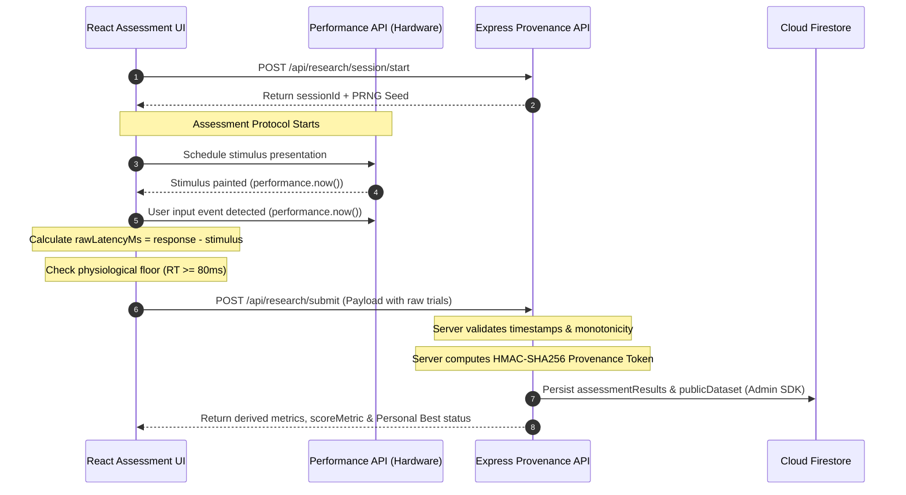

# PULSE System Architecture

This document describes the end-to-end architecture, runtime subsystems, data flow pipelines, and security boundaries of the PULSE platform.

---

## 1. System Topology Overview

PULSE consists of a dual-surface client layer (Desktop SPA + Mobile PWA) connected over REST/HTTPS to an Express Node.js application server, backed by Google Cloud Firestore and Firebase Authentication.

```mermaid
graph TD
    ClientDesktop["Desktop Client (React 19 / Vite)<br/>Route: /"] -->|HTTPS / JSON| Server["Express API & Provenance Engine<br/>(server/ / Node.js)"]
    ClientMobile["Mobile PWA Client (React 19 / Vite)<br/>Route: /mobile/"] -->|HTTPS / JSON| Server

    Server -->|Admin SDK (Signed Writes)| Firestore[("Google Cloud Firestore")]
    Server -->|Token Verification| FirebaseAuth["Firebase Authentication<br/>(Anonymous Auth)"]

    ClientDesktop -.->|Read-Only Queries| Firestore
    ClientMobile -.->|Read-Only Queries| Firestore
```

---

## 2. Dual-Surface Frontend Architecture

PULSE separates desktop and mobile web experiences into distinct build pipelines while sharing protocol validation logic and data models.

```
/
├── src/                      # Desktop Web Client (Port 3000)
│   ├── App.tsx               # Root desktop router & AnimatedBackground
│   ├── main.tsx              # Desktop entry point
│   ├── components/           # Desktop assessment views, analytics, brand
│   └── lib/                  # State stores, timing tools, Firestore client
│
└── mobile/                   # Mobile PWA Subproject (Vite sub-config)
    ├── index.html            # Mobile-optimized viewport HTML
    ├── vite.config.ts        # Mobile Vite configuration
    └── src/                  # Mobile touch assessment views & PWA lifecycle
```

### Device Auto-Routing
- [`src/lib/deviceRouting.ts`](../src/lib/deviceRouting.ts) inspects User-Agent signatures and screen width breakpoints (`< 768px`).
- Express preserves document routes; client-side routing applies device detection after the browser can inspect its user agent and viewport. Server redirects are reserved for explicit routing flags/preferences.
- Cross-surface navigation allows manual override if a user explicitly requests the desktop or mobile interface.

---

## 3. Assessment Execution & Timing Pipeline

Measurement integrity is maintained through hardware-synchronized sampling:



---

## 4. State Management Architecture

State is partitioned across four clear tiers:
1. **In-Memory Volatile State:** [`src/lib/inMemorySessionStore.ts`](../src/lib/inMemorySessionStore.ts) holds active session trial arrays during assessment runs to prevent unnecessary I/O during timing loops.
2. **Local Client Storage & Cookie Sync:** [src/lib/settingsStore.ts](../src/lib/settingsStore.ts) and [src/lib/useSystemTheme.ts](../src/lib/useSystemTheme.ts) manage user preferences (themeMode: light/dark/system, reduced motion, sound effects, exhibition mode) synchronized across localStorage and pulse_settings cookies with reactive DOM bindings (data-theme, color-scheme).
3. **PWA Offline Store:** [`src/lib/pwaStore.ts`](../src/lib/pwaStore.ts) tracks install prompt readiness and service worker updates.
4. **Cloud Database:** Google Cloud Firestore holds persistent assessment trials, results, public datasets, leaderboards, and admin audit logs.

---

## 5. Server Subsystem & API Routing (`server/`)

The Express server handles four core operational domains:

```
[Express Server (server/index.ts)]
  │
  ├── 1. Rate Limiting Middleware
  │     ├── /api/leaderboard          ──► leaderboardReadLimiter (600 req / 15 min per IP)
  │     ├── /api/research/session/*   ──► sessionStartLimiter (30 req / 15 min per UID+IP)
  │     ├── /api/sessions/*           ──► generalSessionsLimiter (60 req / 15 min per UID+IP)
  │     ├── /api/research/submit      ──► sessionSubmitLimiter (30 req / 15 min per UID+IP)
  │     ├── /api/leaderboard/submit   ──► leaderboardSubmitLimiter (30 req / 15 min per UID+IP)
  │     ├── /api/*/verify-provenance  ──► verificationLimiter (60 req / 15 min per IP)
  │     └── /api/*                    ──► generalApiLimiter (2000 req / 15 min per IP)
  │
  ├── 2. Provenance & Attestation Engine
  │     ├── /api/research/session/start ──► Session initialization
  │     ├── /api/research/submit        ──► Multi-trial validation & HMAC token signing
  │     ├── /api/research/verify-provenance ──► Token signature verification
  │     └── /api/personal-best          ──► High score queries
  │
  ├── 3. Public Dataset API
  │     ├── /api/research/dataset       ──► Filtered public benchmark queries
  │     └── /api/research/dataset/summary ──► Cohort summary statistics
  │
  └── 4. Leaderboard API
        ├── /api/leaderboard            ──► Opted-in top 100 entries per protocol
        ├── /api/leaderboard/submit     ──► Alias validation, best-score checks & leaderboard write
        ├── /api/leaderboard/mine       ──► Participant GDPR data erasure
        └── /api/leaderboard/verify-provenance ──► Token signature verification
```

### 5.1 Module Layout

`server.ts` is a thin entry point (kept for `npm run dev`, the esbuild bundle and `api/index.ts` on Vercel). The application is composed in `server/index.ts` from the following modules:

```
server/
├── index.ts                     App bootstrap: middleware order, route registration, listen
├── container.ts                 Dependency injection container wiring repositories to services
├── config/
│   ├── constants.ts             Valid age groups / assessment types, trial + idempotency limits
│   ├── firebaseAdmin.ts         Admin SDK initialisation, Firestore accessor, diagnostics
│   ├── firestoreRateLimitStore.ts Firestore-backed distributed rate limit store
│   └── rateLimits.ts            Route-scoped rate limiters (Firestore-backed distributed counters)
├── middleware/
│   ├── security.ts              /api prefix normalisation, security headers, CSP
│   └── deviceRouting.ts         Cookie/UA helpers, staging noindex, desktop <-> /mobile redirection
├── routes/
│   ├── researchRoutes.ts        session/start, submit, personal-best, verify-provenance, dataset (+summary)
│   ├── leaderboardRoutes.ts     leaderboard read, submit, mine (erasure), verify-provenance
│   ├── telemetryRoutes.ts       targeted page view tracking (/api/telemetry/page-view)
│   └── staticRoutes.ts          Vite dev middleware or dist/ static serving + SPA/PWA fallbacks
├── repositories/
│   ├── firestore/               Firestore persistence implementations (sessions, submissions, leaderboards)
│   └── interfaces/              Repository contracts enabling test mock injection
├── services/
│   ├── provenanceService.ts     HMAC-SHA256 signing, constant-time compare, canonical trials digest
│   ├── sessionService.ts        Firestore-backed experiment session lookup and validation
│   ├── researchService.ts       Dataset query filtering, trial validation, and aggregation
│   ├── personalBestService.ts   Personal best retrieval and ranking derivation
│   ├── idempotencyService.ts    Bounded process-local idempotency cache
│   ├── leaderboardAppService.ts Opt-in rules, best-per-owner filtering, and score-metric validation
│   └── telegramNotifierService.ts Durable outbox worker, HTML parse mode, chat rate-limiting
└── engines/                     Pure functions: no Express, no Firestore
    ├── assessmentEngine.ts      Structural / chronological / physiological trial checks + protocol dispatch
    ├── reactionCalculator.ts    Visual reaction time, foreperiod generation, temporal dynamics
    ├── flankerCalculator.ts     Direction (flanker) task and interference costs
    ├── stroopCalculator.ts      Color-recognition (Stroop) task
    ├── memoryCalculator.ts      Block (Corsi) and number (digit span) memory
    ├── assessmentTypes.ts       Assessment-type alias normalisation
    ├── prng.ts                  Seeded PRNG shared by server-side stimulus reconstruction
    └── types.ts                 Shared derivation context / result types
```

The `engines/` layer can be unit-tested without HTTP wrappers (see `tests/unit/serverEngines.test.ts`).

---

## 6. Firestore Security & Trust Boundaries

The Firestore database enforces strict role isolation via [`firestore.rules`](../firestore.rules):

| Collection | Client Read | Client Write | Server Backend (Admin SDK) |
| :--- | :--- | :--- | :--- |
| `experimentSessions` | Authenticated Owner (`uid == auth.uid`) | **DENIED** (`false`) | Full Read/Write |
| `assessmentTrials` | Authenticated Owner (`participantId == auth.uid`) | **DENIED** (`false`) | Full Read/Write |
| `assessmentResults` | Authenticated Owner (`participantId == auth.uid`) | **DENIED** (`false`) | Full Read/Write |
| `publicDataset` | Authenticated Users (`auth != null`) | **DENIED** (`false`) | Full Read/Write |
| `leaderboardResults` | **DENIED** (`false`, API-only) | **DENIED** (`false`) | Full Read/Write |
| `leaderboardPrivateMeta` | **DENIED** (`false`) | **DENIED** (`false`) | Full Read/Write |
| `leaderboardOwnerIndex` | **DENIED** (`false`) | **DENIED** (`false`) | Full Read/Write |
| `adminAuditLogs` | **DENIED** (`false`) | **DENIED** (`false`) | Full Read/Write |


## 7. Assessment Measurement vs. Live-Timer UI Pacing

Desktop and mobile assessment surfaces use the shared `shared/timing/framePacer.ts` helper to target an average of approximately 60 live-timer UI text updates per second. This is a software presentation optimization only: it does not set the physical display refresh rate, quantize stimulus presentation timestamps, or promise uniform timer intervals on variable-refresh displays.

Stimulus presentation and response events continue to use high-resolution monotonic browser timestamps. For Visual Reaction, Direction, and Color Recognition, new protocol/metrics metadata is `v1.1.0`: scoring uses unadjusted browser-measured latency rounded to two decimal places, without theoretical half-frame offset subtraction. Memory assessments remain `v1.0.0`. The shared `getAssessmentVersionMetadata()` contract is used by both server write paths so `publicDataset` and `assessmentResults` carry synchronized version metadata. Historical digest normalization remains unchanged.
