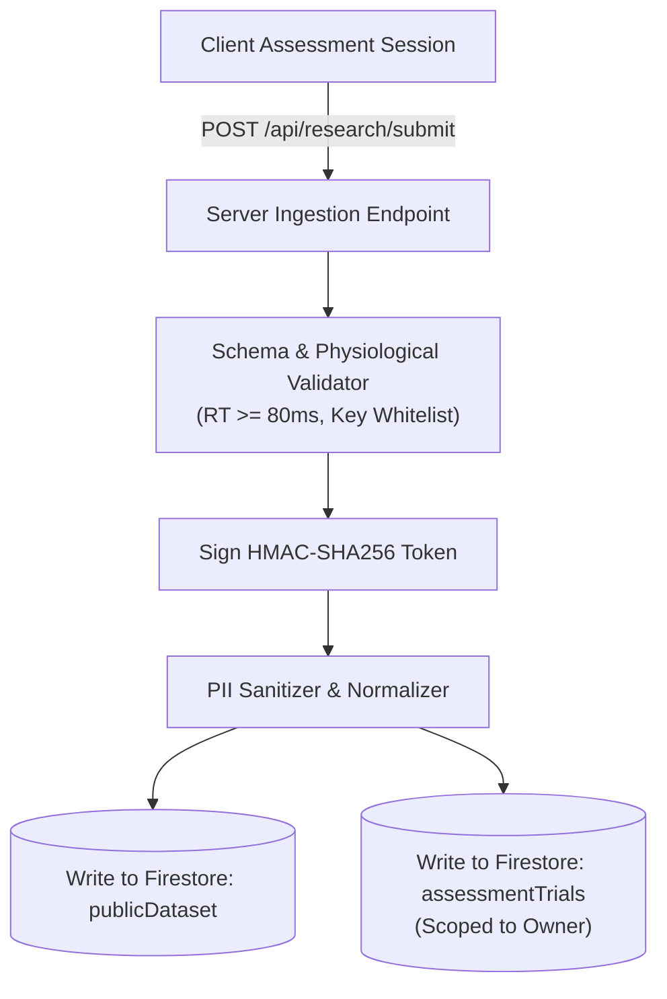

# PULSE Research Dataset Pipeline Specification

This document details the ingestion, sanitization, aggregation, and export pipelines powering the PULSE open research dataset.

---

## 1. Dataset Objectives & Ethical Governance
The PULSE Research Dataset Explorer (`/dataset`) provides an open empirical benchmark for cognitive science, human-computer interaction, and psychometric research.

### Zero-PII Guarantee
Every public observation complies with strict data minimization standards:
- **No IP Addresses:** Client IP addresses are processed in ephemeral memory for rate limiting and never written to Firestore.
- **No Participant Identifiers:** Firebase UIDs and session UUIDs are stripped during public dataset ingestion.
- **Coarse Temporal Aggregation:** Exact timestamps are replaced with `completedAtMonth` (`YYYY-MM`).
- **Broad Cohort Buckets:** Age is captured exclusively in 7 normalized brackets (`Children (8–12)` through `Seniors (76+)`).

---

## 2. Ingestion & Normalization Flow

---

## 3. Querying & Filtering Engine

### Ingestion & Query Implementation
The interactive dataset explorer interface is provided by [`src/components/Dataset.tsx`](../../src/components/Dataset.tsx) and [`mobile/src/components/Dataset.tsx`](../../mobile/src/components/Dataset.tsx) for live empirical analysis. Dedicated protocol dataset views are implemented in [`src/components/DirectionDataset.tsx`](../../src/components/DirectionDataset.tsx) and [`mobile/src/components/DirectionDataset.tsx`](../../mobile/src/components/DirectionDataset.tsx).

When public documents are fetched via `/api/research/dataset`, shared aggregation pipelines in [`shared/dataset/analytics.ts`](../../shared/dataset/analytics.ts) process raw trials into standardized visualizations:

- **Visual Reaction (VRT):**
  - **Foreperiod Dynamics:** Grouped into 6 non-overlapping foreperiod intervals (`100–500ms` through `2501–3000ms`), selecting the latest valid attempt per session.
  - **Consistency Distribution:** CV-derived scores grouped into discrete intervals with Desktop vs Mobile breakdown.
  - **Trial Validity Breakdown:** Mutually exclusive 4-category classification (*Valid*, *Premature* $< 80\text{ms}$, *Anticipatory*, *Timeout* $\ge 3000\text{ms}$).
  - **Population Progression:** Single overall population median RT curve across Trials 1–10.

- **Direction Choice Reaction Time (CRT):**
  - **Dual-Metric Overview:** 4 cards pairing reaction time with accuracy (Median, Desktop vs Mobile, Total Attempts & Correct, Average).
  - **Age Cohorts:** Side-by-side comparative views for Median RT and Median Accuracy across valid demographic cohorts.
  - **Directional Profile:** 4-cardinal-axis Radar (`UP`, `RIGHT`, `DOWN`, `LEFT`) supporting Accuracy %, Reaction Time, or Both side-by-side.
  - **Speed vs Accuracy Matrix:** Aggregated $4 \times 5$ density heatmap with privacy-safe cell intensities (RT columns: $<300\text{ms}$, $300\text{--}500\text{ms}$, $500\text{--}700\text{ms}$, $700\text{--}900\text{ms}$, $\ge 900\text{ms}$; Accuracy rows: $<70\%$, $70\text{--}80\%$, $80\text{--}90\%$, $90\text{--}100\%$).
  - **Attempt Outcomes:** 4-tier mutually exclusive ring (*Correct*, *Incorrect Direction*, *Premature*, *Timeout*).
  - **Trial Progression:** Population median RT progression across Trials 1–10.

### Filter Dimensions
1. **Assessment Protocol:** `visual-reaction`, `direction`, `colour-recognition`, `block-memory`, `number-memory`.
2. **Age Cohort:** Multi-cohort or single-cohort breakdown.
3. **Device Category:** `desktop` vs `mobile`.
4. **Time Range:** Filterable by completion month (`YYYY-MM`).

---

## 4. Export Formats

The Dataset Explorer supports instant one-click research exports:
- **CSV Export:** Tabular comma-separated values containing trial latencies, derived means, medians, consistency scores, and cohort labels.
- **JSON Export:** Full hierarchical structured representation matching `publicDataset` schema v1 for automated Python/R research scripts.
