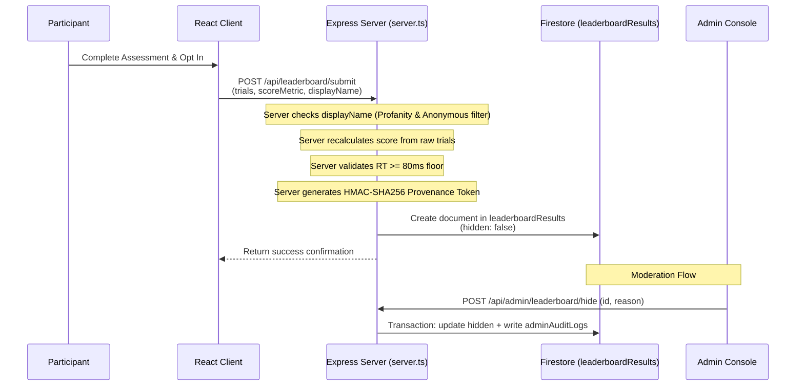

# PULSE Leaderboard & Cryptographic Provenance Specification

This document specifies the opt-in leaderboard workflow, anti-cheat validation pipeline, cryptographic HMAC attestation, and administrative moderation system.

---

## 1. Leaderboard Architecture

The PULSE leaderboard (`/leaderboard`) ranks the top 100 verified scores across each assessment protocol:

---

## 2. Opt-In & Alias Validation Rules
- **Explicit Consent:** Scores are never posted to public rankings without the participant completing the opt-in modal.
- **Anonymous Alias Rejection:** Generic pseudonyms (`Anonymous`, `Unknown`, `Guest`, `Participant-XXXX`) are barred from public rank tables to preserve genuine competitive transparency.
- **Alias safety:** Public aliases are normalized using Unicode NFKC, checked for unsupported control/bidi characters, URL/email-like contact details, digit-heavy strings, generic anonymous aliases, and a curated set of disallowed terms. Invalid names are rejected at submission; legacy invalid aliases are filtered from public reads rather than rewritten in place.

---

## 3. Cryptographic Provenance Model
- **HMAC Secret:** The server generates a 64-character SHA-256 HMAC token calculated over:
  - `assessmentType`
  - `scoreMetric`
  - `ageGroup`
  - `timestamp`
  - Digest of raw trial observations
- **Verification Endpoint:** The server exposes `/api/leaderboard/verify-provenance` to allow independent cryptographic audits of any leaderboard record against the current signing key.

---

## 4. Administrative Moderation Controls
- **Soft-Hide (`/api/admin/leaderboard/hide`):** Sets `hidden = true` on flagged entries without deleting historical data. Soft-hidden entries are instantly filtered out of the public leaderboard query.
- **Hard-Delete (`/api/admin/leaderboard/delete`):** Permanently purges fraudulent or malicious entries from Firestore.
- **Audit Ledger (`adminAuditLogs`):** Hide/unhide/delete and their audit entries are written in one Firestore transaction. The current moderation repository writes the actor as the generic value `admin`, not a unique moderator identity. No separate automated audit-retention job was verified in the reviewed application code.

## 5. Ranking, identity, and tie policy

- **Leaderboard scope:** Each participant contributes at most one visible, approved best score per canonical assessment. Worse or tied attempts are stored as private submission receipts and are not ranked. A flagged candidate is retained as a hidden moderation row while the approved best remains visible; it becomes the public best only if moderation approves it and it outperforms the current best.
- **Legacy data:** Historical duplicate visible rows are not deduplicated by ordinary API requests. Run the best-per-owner migration during a maintenance window after the privacy migration. Rows without a trusted private owner mapping and hidden moderation cases are intentionally left unchanged for manual review.
- **Display names:** Aliases are not verified identities and are not unique participant identifiers. Different participants may choose the same alias, but normalized new data exposes only one current approved best row per owner/assessment.
- **Ordering:** Speed assessments sort by lower score first; memory assessments sort by higher score first. Full precision determines server ordering. Rows whose displayed scores are identical share a displayed rank; sorting within an equal-score group is deterministic by completion time and entry ID.
- **Refresh:** Concurrent in-flight reads for the same assessment share one Firestore request. Completed reads are not cached for five seconds; HTTP caching is disabled on the public endpoint, so the next request reloads data. Rankings are not a live push stream.
