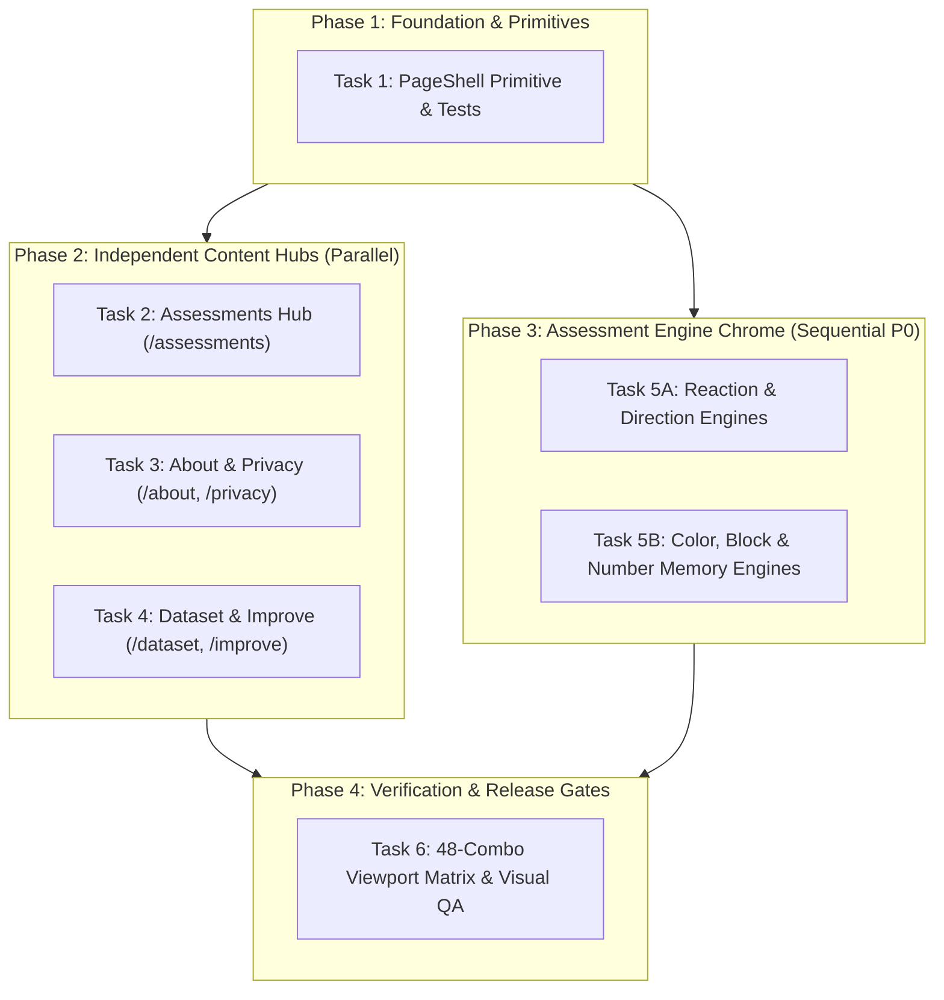

# PULSE 2.1 — Light Design System Expansion: Architectural Implementation Plan (Hardened v3)

> **Role & Policy:** Senior Frontend Architect, QA Specialist, Accessibility Reviewer, and Cognitive Measurement-Integrity Specialist.
> **Repository:** `Affan0786isOP/PULSE-2.1` | **Active Branch:** `main` (direct progression)
> **Rule:** PLAN REVISION ONLY. No application source code modifications, no runtime behavior changes, no premature code commits.

---

## 1. Executive Summary & Repository Baseline State

### 1.1 Verified Repository State (2026-10-18)
- **Branch & Commit Base:** Currently on `main` at commit `674486b` (`docs: add subagent implementation plan for design system unification`), ahead of `origin/main` by 1 commit. Working directory has only documentation modifications and pre-existing local untracked skills.
- **Package Manager & Toolchain:** `npm@10.9.7`, React `19.0.1`, Vite `6.4.3`, Tailwind CSS `v4.1.14`, Motion `12.23.24`, Node.js ESM.
- **Verification Suites Executed & Passing:**
  - Full Unit & Integration Test Suite (`npm test`): **43 test files passed, 380 unit tests passed (0 failures)**.
  - Full Type Checks (`npm run check` -> `tsc --noEmit && cd mobile && tsc --noEmit`): **Clean, 0 errors**.
  - Full Production Build (`npm run build` -> Vite root + Vite mobile + SEO static generator + esbuild server): **Clean build (0 errors)**.
- **Design Alignment & Scope Invariants (Clarified via User Alignment):**
  1. **Branch Target:** Work proceeds directly on `main`.
  2. **Global Shell Uniformity:** `Home.tsx` and `Leaderboard.tsx` will also be refactored to consume `PageShell`, standardizing accessibility, landmarks, and metadata across the entire application while **strictly preserving their exact visual look, scaling, and wave positioning**.
  3. **Assessment Engine Chrome:** Minimal light edge chrome only — the active test workspace/canvas remains an uninterrupted dark testing environment (`#12161B`) for maximal cognitive focus and stimulus contrast, while only the outer top navigation bar and footer adopt the light theme chrome.

---

## 2. Core Architectural Invariants & Decisions

### 2.1 One PageShell Contract & Explicit Metadata Architecture
To prevent nested `<main id="main-content">` landmarks, duplicate footers, competing SEO tags, or conflicting scroll/padding contexts:
1. **Single Landmark & Skip Navigation:** `PageShell` renders the application's single `<main id="main-content" tabIndex={-1}>` landmark, preceded by the accessible skip-to-content anchor. Migrated page components render semantic section/article content *inside* `PageShell` and MUST NOT render an outer `<main>` tag.
2. **Authoritative Single-Owner Metadata Strategy (Zero Collision Architecture):**
   - For all client-rendered views wrapped in `PageShell` (`/`, `/leaderboard`, `/assessments`, `/about`, `/privacy`, `/dataset`, `/improve`, and all assessment test engines), **`PageShell` is the sole, authoritative metadata manager**.
   - `PageShell` consumes `shared/seoMetadata.json` as the default single source of truth for `title`, `description`, `canonicalUrl`, and `noindex` based on `currentView` / route path.
   - `PageShell` accepts optional `schema?: Record<string, any>` (e.g. `About.tsx`'s detailed `ABOUT_SCHEMA` graph, or `Home.tsx`'s `HOME_SCHEMA`). When provided, it seamlessly serializes and injects this schema into `#pulse-seo-jsonld` with owner-id tracking without requiring an inner `<SEO>` component.
   - To guarantee zero race conditions on client-side navigation, `RouteSEO`'s contract in `src/components/RouteSEO.tsx` or route configuration is updated so that `RouteSEO` strictly yields to shell-managed pages (e.g., skips execution when a route is handled by `PageShell` or checks a shared mount registry/attribute `data-seo-owner="shell"`), ensuring only **one** component touches document head tags per navigation.
   - Build-time SEO pre-rendering (`scripts/generate-seo-pages.mjs`) remains untouched, preserving direct-load HTML shells, indexability flags, and canonical URLs.

```typescript
// Refined PageShell Contract (src/components/layout/PageShell.tsx)
export interface PageShellProps {
  children: React.ReactNode;
  currentView: string;
  // Metadata options: defaults are automatically pulled from shared/seoMetadata.json
  customTitle?: string;
  customDescription?: string;
  schema?: Record<string, any>; // Strictly preserves Home.tsx & About.tsx schemas
  noindex?: boolean;
  canonicalUrl?: string;
  
  // Layout & Navigation options
  onNavigate?: (view: string) => void;
  onBack?: () => void;
  decorativeWaves?: 'bottom' | 'side' | 'none';
  maxWidth?: 'sm' | 'md' | 'lg' | 'xl' | '2xl' | '4xl' | '5xl' | '6xl' | 'full';
  showNavbar?: boolean;
  showFooter?: boolean;
  theme?: 'light' | 'dark-apparatus'; // Supports minimal light edge chrome with dark test canvas
  contentClassName?: string;
}
```

### 2.2 P0 Gate — Assessment Stimulus & Timing Integrity
**Cognitive benchmarking stimuli are sacred. Test stimuli must NOT be redesigned, inverted, or recolored.**
1. **Minimal Light Edge Chrome Around Dark Apparatus Canvas:**
   - *Outer Edge Chrome (Light):* Top navigation bar (`Navbar theme="light"`) and optional footer.
   - *Active Assessment Canvas (Dark #12161B):* The entire testing workspace remains a distraction-free dark field (`bg-[#12161B]`) so that active stimuli, arrows, Stroop words, blocks, and digit spans retain maximum contrast and identical baseline perceptual calibration.
2. **Explicit Freezing of State-Dependent Stimuli:**
   - `ReactionTest`:
     - `READY`: Background `#12161B`, border `#20262D`, text `#8490A0` ("Click or press space to start").
     - `AWAITING_STIMULUS`: Background `#12161B`, amber warning border (`#F2B84B`), status text `#F2B84B` ("Wait for green...").
     - `STIMULUS_ACTIVE`: Background green/active target (exact baseline `!bg-[var(--text-primary)] !border-[var(--text-primary)]` or green flash), timer `#0B0D10`.
     - `TRIAL_COMPLETE` (Success): Green border `#34C759`, green timer `#34C759`.
     - `TRIAL_COMPLETE` (False Start / Error): Red border `#E05260`, shake animation, error status `#E05260`.
   - `DirectionTest`: Dark stimulus well with vibrant directional arrows (Up, Down, Left, Right).
   - `ColorTest`: Dark stimulus well with exact Stroop colored text (`currentColor.value`).
   - `BlockMemoryTest`: Dark grid well (`.block-cell` with illuminated cyan active blocks `#22C7D6`).
   - `NumberMemoryTest`: Dark digit well with high-visibility white digit sequence presentation.
3. **Zero Modification to Timing Hooks & Event Loops:**
   - Absolute freeze on `performance.now()` math, `useRefreshRate` display midpoint calibration, animation frame IDs, trial dataset observation collections, and Firestore idempotency keys.
   - Preserve `pulse_settings_open` event listener aborting active engine loops.

---

## 3. Dependency-Aware Implementation Phases



### Strict File Ownership Matrix (Conflict-Free Delegation)
| Task | Target Files to Modify / Create | Isolated Test Files |
|---|---|---|
| **Task 1: Shell Primitive** | `src/components/layout/PageShell.tsx` (new) | `tests/unit/pageShell.test.tsx` (new) |
| **Task 2: Assessments Hub** | `src/components/Assessments.tsx` | `tests/unit/assessmentsPage.test.tsx` (new) |
| **Task 3: About & Privacy** | `src/components/About.tsx`, `src/components/ResearchPrivacyPolicy.tsx` | `tests/unit/aboutPrivacy.test.tsx` (new) |
| **Task 4: Dataset & Improve** | `src/components/DatasetComingSoon.tsx`, `src/components/Improve.tsx` | `tests/unit/improveDataset.test.tsx` (new) |
| **Task 5A: Simple/Choice Engines** | `src/components/ReactionTest.tsx`, `src/components/DirectionTest.tsx` | `tests/unit/reactionDirectionEngines.test.tsx` (new) |
| **Task 5B: Conflict/Memory Engines**| `src/components/ColorTest.tsx`, `src/components/BlockMemoryTest.tsx`, `src/components/NumberMemoryTest.tsx` | `tests/unit/memoryColorEngines.test.tsx` (new) |
| **Task 6: Visual QA & Audit** | `scratch/capture-design-system-audit.mjs` (harness) | Visual diff reports & Playwright artifacts |

---

## 4. Detailed Task Specifications

### Task 1: Design System Primitives & Shared Shell (`PageShell.tsx`)
- **Objective:** Create the accessible, responsive, light-mode layout wrapper that standardizes the background gradient, dot-matrix, wave graphics, Navbar, single `<main id="main-content">` landmark, skip navigation, safe-area padding, and authoritative single-owner metadata management.
- **Dependencies:** None (uses existing `Navbar`, `Footer`, `DesktopWaveGraphic`, `LeaderboardSideWaves`, `shared/seoMetadata.json`).
- **Files:** `src/components/layout/PageShell.tsx` (new), `src/components/RouteSEO.tsx` (modify to yield to shell-managed routes).
- **Pre-Implementation Test (`tests/unit/pageShell.test.tsx`):**
  - Verify presence of skip link (`href="#main-content"`) and accessible focus styles.
  - Verify single `<main id="main-content" tabIndex={-1}>` landmark rendered with provided children.
  - Verify `Navbar` rendered with `theme="light"` and active view forwarding.
  - Verify `Footer` rendered conditionally based on `showFooter` prop.
  - Verify single authoritative metadata management: updates `document.title`, description, canonical URL from `shared/seoMetadata.json`.
  - Verify schema injection: when `schema` prop is passed (e.g. `About` graph), injects `#pulse-seo-jsonld` with owner tracking without duplicating or wiping tags.
  - Verify `RouteSEO` does not trigger competing head mutations on shell-managed routes.
  - Verify wave rendering: `'bottom'` renders `DesktopWaveGraphic`, `'side'` renders `LeaderboardSideWaves`, `'none'` renders neither.
  - Verify background dot-grid contains `pointer-events-none` and `aria-hidden="true"`.
  - Verify `data-theme="light"` on root container.
- **Implementation:**
  - Create `src/components/layout/PageShell.tsx` strictly satisfying the single-owner `PageShellProps` contract.
  - Update `src/components/RouteSEO.tsx` to yield on shell-managed routes.
- **Exit Criteria:**
  - `npm test tests/unit/pageShell.test.tsx` passes.
  - `npm run check` passes.

---

### Task 2: Migrate Assessments Hub Page (`/assessments`)
- **Objective:** Modernize `/assessments` to the light-mode card system with softened pale-blue medallions (`#E0F2FE`), prominent protocol tags, and outline secondary CTA buttons (`Try [Protocol] →`) matching Home.
- **File:** `src/components/Assessments.tsx`.
- **Pre-Implementation Test (`tests/unit/assessmentsPage.test.tsx`):**
  - Verify all 5 canonical protocols (`reaction-test`, `direction-test`, `colour-recognition`, `block-memory`, `number-memory`) are rendered with truthful protocol numbers and badges.
  - Verify clicking an active card invokes `onNavigate` with the canonical route.
  - Verify disabled states remain inaccessible (`opacity-40 cursor-not-allowed` when status != `AVAILABLE`).
  - Verify light card styling (`bg-white/90 border-slate-200/80`) and no duplicate `<main>` landmarks.
- **Implementation:**
  - Refactor `src/components/Assessments.tsx` to wrap content in `<PageShell currentView="assessments" decorativeWaves="side" onNavigate={onNavigate}>`.
  - Replace dark surface tokens (`var(--surface-1)`, `var(--bg-base)`) with light card classes (`bg-white/80 border-slate-200/80 hover:border-[#0066FF]/40 hover:shadow-md`).
  - Soften icon container to pale blue (`bg-[#EAF5FF] border-[#D0E7FF] text-[#0066FF]`).
  - Add secondary outline CTA button: `border border-[#BFDBFE] bg-white text-[#0066FF] hover:bg-[#F0F7FF]`.
- **Exit Criteria:**
  - `npm test tests/unit/assessmentsPage.test.tsx` passes.
  - `npm run check` passes.

---

### Task 3: Migrate About & Privacy Pages (`/about`, `/privacy`)
- **Objective:** Modernize scientific documentation, methodology tables, and privacy disclosures to the light-theme editorial standard while strictly preserving all copy, scientific citations, formulas, and table semantics.
- **Files:** `src/components/About.tsx`, `src/components/ResearchPrivacyPolicy.tsx`.
- **Pre-Implementation Test (`tests/unit/aboutPrivacy.test.tsx`):**
  - Verify `About.tsx` preserves all protocol descriptions, scientific formulas (`performance.now()`), and JSON-LD `ABOUT_SCHEMA`.
  - Verify `ResearchPrivacyPolicy.tsx` preserves 4-tier data table semantics (`th`, `td`, scope), last updated date, and retention policies.
  - Verify no duplicate `<main>` landmarks or duplicate navbars.
- **Implementation:**
  - Wrap `About.tsx` in `<PageShell currentView="about" schema={ABOUT_SCHEMA} decorativeWaves="side">`.
  - Wrap `ResearchPrivacyPolicy.tsx` in `<PageShell currentView="privacy" canonicalUrl="https://pulse-lab.in/privacy" decorativeWaves="bottom">`.
  - Replace dark cards with light editorial cards (`bg-white/95 border-slate-200/80 shadow-xs`).
  - Style table headers with `#F8FAFC`, borders with `border-slate-200`, and text with `#334155`.
- **Exit Criteria:**
  - Text diff verification confirming 0% copy omission.
  - `npm test tests/unit/aboutPrivacy.test.tsx` passes.
  - `npm run check` passes.

---

### Task 4: Migrate Dataset & Performance Guide (`/dataset`, `/improve`)
- **Objective:** Modernize `/dataset` coming-soon card and the interactive `/improve` Performance Guide (habits checklist, physiological factor cards, research ledger, sidebar navigation) with persistent checkbox states and light aesthetic.
- **Files:** `src/components/DatasetComingSoon.tsx`, `src/components/Improve.tsx`.
- **Pre-Implementation Test (`tests/unit/improveDataset.test.tsx`):**
  - Verify `DatasetComingSoon` displays honest coming-soon messaging and navigation to `/assessments`.
  - Verify `Improve` checklist toggle updates state, triggers `savePersistedChecklist`, and persists across remounts.
  - Verify checklist reset button clears persisted state (`clearPersistedChecklist`).
  - Verify accessible keyboard interactions: native checkboxes respond to `Space` key with visible `#0066FF` focus rings.
- **Implementation:**
  - Wrap `DatasetComingSoon.tsx` in `<PageShell currentView="dataset" decorativeWaves="bottom" noindex={true}>`.
  - Wrap `Improve.tsx` in `<PageShell currentView="improve" decorativeWaves="none">` (integrating `HookSidebar` and `ScrollProgress`).
  - Update factor cards and research ledger to light surfaces (`bg-white border-slate-200/80`).
  - Ensure native `<input type="checkbox">` elements utilize accent color `#0066FF` with `focus-visible:ring-2 focus-visible:ring-[#0066FF]`.
- **Exit Criteria:**
  - `npm test tests/unit/improveDataset.test.tsx` passes.
  - `npm run check` passes.

---

### Task 5: Assessment Test Canvases Calibration & Light Chrome
- **Objective:** Wrap all 5 assessment engines with minimal light edge chrome (light `Navbar` and light `Footer`) while strictly maintaining an uninterrupted, calibrated dark testing canvas (`#12161B`) for maximal cognitive focus and stimulus contrast.
- **Task 5A Files:** `src/components/ReactionTest.tsx`, `src/components/DirectionTest.tsx`.
- **Task 5B Files:** `src/components/ColorTest.tsx`, `src/components/BlockMemoryTest.tsx`, `src/components/NumberMemoryTest.tsx`.
- **Pre-Implementation Tests (`tests/unit/reactionDirectionEngines.test.tsx`, `tests/unit/memoryColorEngines.test.tsx`):**
  - Assert that outer shell renders minimal light edge chrome (light `Navbar` at top, light `Footer` at bottom).
  - Assert that the active test canvas remains dark (`#12161B`) and stimulus wells retain calibrated dark styling across `READY`, `AWAITING_STIMULUS`, `STIMULUS_ACTIVE`, and `TRIAL_COMPLETE`.
  - Assert `ReactionTest` state transitions: false starts produce shake animation and red border `#E05260`; successful trials produce green border `#34C759`.
  - Assert `DirectionTest` arrow SVGs render with full contrast and respond to arrow keys.
  - Assert `ColorTest` Stroop words render with correct font color vs word name conflict.
  - Assert `BlockMemoryTest` grid activates with cyan highlights `#22C7D6`.
  - Assert `NumberMemoryTest` digit span presents white numbers on dark display.
  - Assert that `pulse_settings_open` event immediately interrupts active test sequences.
  - Assert result submission calls `submitAssessmentResult` with valid idempotency keys and trial records.
- **Implementation:**
  - Wrap engine pages in `<PageShell theme="dark-apparatus" showFooter={false}>` with light `Navbar`.
  - Keep the active testing workspace in calibrated dark mode (`bg-[#12161B] text-white`).
  - Style age selection dialogs and post-test report cards (`AssessmentResultReward`) with light card aesthetics, `#090D1A` typography, and `#0066FF` primary buttons.
- **Exit Criteria:**
  - `npm test tests/unit/reactionDirectionEngines.test.tsx` passes.
  - `npm test tests/unit/memoryColorEngines.test.tsx` passes.
  - `npm run check` passes.

---

### Task 6: Global Visual QA & Multi-Resolution Route Matrix
- **Objective:** Verify 100% visual consistency and zero stimulus regressions across all 12 routes and 4 standard viewports (48 total combinations) plus targeted dynamic assessment states.
- **Harness:** Dedicated Playwright audit script `scratch/capture-design-system-audit.mjs` serving production build from `dist/` on port `4178`.
- **Viewport Matrix (48 Route-Viewport Combinations):**
  1. `390x844` (Mobile Portrait / DPR 2)
  2. `1280x720` (720p Desktop Baseline)
  3. `1920x1080` (1080p Standard Full HD)
  4. `2560x1440` (1440p QHD)
- **Routes Tested (12):**
  - `/` (Home)
  - `/leaderboard`
  - `/assessments`
  - `/about`
  - `/dataset`
  - `/improve`
  - `/privacy`
  - `/reaction-test`
  - `/direction-test`
  - `/colour-recognition`
  - `/block-memory`
  - `/number-memory`
- **Dynamic Assessment State Captures (4 extra states per engine):**
  - Idle / Ready state
  - Active stimulus state
  - False start / error state
  - Completion / report reward state
- **Visual Acceptance Gates:**
  - No horizontal page overflow or clipped content.
  - No low-contrast text (contrast ratio >= 4.5:1 for body `#334155` on light surfaces).
  - Stimulus well contrast: dark well (`#12161B`) verified behind all active targets.
  - Focus rings clearly visible on keyboard tab navigation.
- **Exit Criteria:**
  - All 48 route-viewport screenshots generated and archived in artifacts directory.
  - Visual inspection report completed with zero unresolved layout defects.

---

## 5. Verification Commands & Acceptance Gates

Every task must pass the strict verification gates in order:

```bash
# 1. Targeted Unit Tests (Task-specific)
npm test tests/unit/<task-test-file>.test.tsx

# 2. Complete Vitest Suite (Zero regressions across existing 380 tests)
npm test

# 3. TypeScript Compilation (Root and Mobile)
npm run check

# 4. Production Build & SEO Pre-rendering
npm run build

# 5. Visual Capture & Inspection
node scratch/capture-design-system-audit.mjs
```

### Final Release Gate Checklist
- [x] Exactly one `<main id="main-content">` landmark per route.
- [x] Skip navigation link functional and keyboard accessible.
- [x] No double navbars, double footers, or competing SEO tags.
- [x] Calibrated dark stimulus wells preserved across all 5 assessment engines.
- [x] Sub-millisecond timing hooks, `performance.now()`, and refresh calibration untouched.
- [x] All scientific copy, formulas, tables, and schemas on About and Privacy 100% preserved.
- [x] Checklist persistence (`localStorage`) and reset in `/improve` fully verified.
- [x] 48 route-viewport screenshots captured and visually approved.
- [x] `npm test`, `npm run check`, and `npm run build` all exit with code 0.
